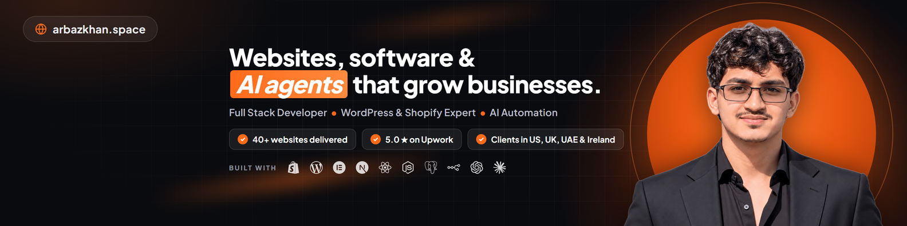

  

## Hi, I'm Arbaz 👋

I build websites, web apps and AI systems that help businesses sell more and work less.

I'm a Full Stack Developer from Karachi, Pakistan with 4+ years of experience and 40+ websites delivered for clients in the US, UK, UAE, Ireland and Pakistan. WordPress and Shopify are the foundation of my work. Alongside them I build custom software, SaaS platforms and AI agents that take repetitive work off a team's plate.

Right now I work as a Full Stack Website Developer at Cubex Solutions, take on freelance projects, and I'm building Brick2Bit, a SaaS agency.

## What I build

**Websites (WordPress and Shopify)**
- Business websites, portfolio websites and landing pages
- Ecommerce stores on Shopify and WooCommerce, built from scratch or redesigned
- Custom Shopify themes in Liquid and custom WordPress plugins (PHP, ACF, JetEngine)
- Figma to WordPress or Shopify, speed optimization, SEO and CRO

**Full stack and software**
- Web apps and SaaS platforms with React, Next.js, Node.js, NestJS and PostgreSQL
- Customer portals, dashboards, membership sites and multi tenant systems
- API integrations, payments, webhooks and third party tools

**AI agents and automation**
- AI chat and support agents for websites, Shopify stores and WhatsApp
- n8n, Make and Zapier workflows for leads, emails, orders and reports
- Built with OpenAI, Claude, Gemini and Groq, grounded in real business data

## Featured projects

| Project | What it is | Stack |
| --- | --- | --- |
| [Accounting SaaS platform](https://github.com/arbaz-webdev/ledger-accounting-platform) | Multi tenant, double entry accounting SaaS with separate portals for the platform owner, accounting firms, accountants and their client businesses. [Live demo](https://ledger-accounting-platform.vercel.app) | Next.js, TypeScript, PostgreSQL, Drizzle, Tailwind |
| [WorkHub](https://github.com/arbaz-webdev/workhub-showcase) | My own SaaS: an all in one workspace for remote and hybrid teams with attendance, project boards, CRM and team chat. In active development, source code private. [Live preview](https://workhub-staging.onrender.com) | Next.js, NestJS, PostgreSQL, Turborepo |
| [Business consultant portfolio](https://github.com/arbaz-webdev/shehzad-portfolio) | Fast single page portfolio for a business developer, with dark and light themes and content editable from one file. [Live site](https://arbaz-webdev.github.io/shehzad-portfolio/) | HTML, CSS, JavaScript, GitHub Pages |
| [React portfolio website](https://github.com/arbaz-webdev/react-portfolio-website) | My earlier personal portfolio with services, experience and portfolio pages | React, TypeScript, Vite, Tailwind, shadcn/ui |

**Client work I can't open source**
- A casting platform for Ireland's online casting network, with separate portals for casters, actors and junior actors
- An English learning platform with a custom WordPress plugin: synced transcripts, typing games, quizzes and lesson plans
- 40+ contractor calculators and a branded PDF estimate builder for a construction equipment maker
- A custom WordPress block theme for a US VoIP and AI answering company
- 20+ ecommerce stores on Shopify and WooCommerce, including custom Liquid themes, bundles and conversion focused product pages
- An AI lead generation system that finds local businesses, audits their websites, scores them and sends personal outreach by email and WhatsApp (354 businesses in one run)
- A WhatsApp AI agent with per customer memory that answers customers and captures leads
- An AI shopping assistant for a Shopify store, grounded in the live product catalog

## Tech I use

**Frontend:** JavaScript, TypeScript, React, Next.js, Tailwind CSS, HTML, CSS 
**Backend:** Node.js, NestJS, PHP, PostgreSQL, MySQL, Supabase, Drizzle ORM, REST, GraphQL 
**Ecommerce and CMS:** Shopify (Liquid, Online Store 2.0, Shopify Plus), WordPress, WooCommerce, Elementor, ACF, JetEngine, Gutenberg block themes 
**AI and automation:** n8n, Make, Zapier, OpenAI, Claude, Gemini, Groq, LangGraph, WhatsApp Cloud API, Klaviyo 
**Tools and hosting:** Git, GitHub Actions, Docker, Vercel, Render, Cloudflare Workers, Figma

  

## Let's work together

I'm open to freelance projects and long term work on websites, SaaS products and AI automation.

- Portfolio: [arbazkhan.space](https://arbazkhan.space)
- LinkedIn: [linkedin.com/in/arbazkhan-webdev](https://www.linkedin.com/in/arbazkhan-webdev/)
- Upwork: [upwork.com/freelancers/arbazwebdev](https://www.upwork.com/freelancers/arbazwebdev)
- Fiverr: [fiverr.com/arbazkhan973](https://www.fiverr.com/arbazkhan973)
